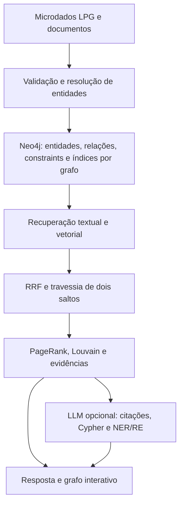

# Arquitetura e modelo de conhecimento

## Contexto

Domínio: análise rastreável de microdados do ensino superior, ano 2024. A expressão “centro de microdados” se refere à organização lógica de dados, consulta e procedência, não à implementação de infraestrutura física de datacenter.

O banco é **Neo4j 5.26 Community** (Docker) com o driver oficial `neo4j` 5.28.8, conforme o enunciado. A interface é Streamlit e pode ser editada no VS Code. Docker Compose inicia o banco (com APOC e GDS como plugins opcionais) e a interface.



## Entidades e relações

Os rótulos originais do repositório são preservados. Todos os nós também recebem `Entity`, `id`, `kind`, `name`, `name_norm`, `source_file` e `graph`. Códigos como `CO_IES` permanecem strings. Indicadores `QT_*` são inteiros; flags `IN_*` são booleanos; vazios não são materializados como propriedades.

| Origem | Relação | Destino | Uso |
|---|---|---|---|
| OfertaCurso | OFERTA_DE | Curso | Identidade acadêmica |
| OfertaCurso | OFERTADA_POR | IES | Instituição responsável |
| OfertaCurso | LOCALIZADA_EM | Municipio | Localização da oferta |
| Municipio | PERTENCE_A_UF | UF | Geografia |
| UF | PERTENCE_A_REGIAO | Regiao | Geografia |
| Curso | OFERTADO_POR | IES | Instituição do curso |
| IES | SEDIADA_EM | Municipio | Sede, distinta do local da oferta |
| Curso | CLASSIFICADO_EM | CineRotulo | Classificação CINE |
| Documento | CONTEM | Trecho | Procedência documental |
| Trecho | MENCIONA | Entity | Relação extraída de texto (dicionário ou LLM) |
| Entity | SE_RELACIONA_COM | Entity | Relação extraída por LLM, com `relacao`, `trecho`, `metodo` |

Outros rótulos/relações de classificação, rede e mantenedora também são importados. O modelo original completo está em `lpg/schema/modelo.md`.

## Identidade, integridade e reimportação

`id = 2024:<ID original LPG>` mantém identidades distintas entre instituições/cursos com o mesmo nome. `MERGE` por ID torna a reimportação idempotente. Não se fundem cursos apenas pelo nome.

**Partição lógica:** toda consulta filtra pela propriedade `graph` (nome do grafo lógico configurado em `GRAPH_NAME`), então vários conjuntos de dados coexistem no mesmo servidor sem se misturar. A unicidade é composta: constraint `(n.id, n.graph) IS UNIQUE`. Obrigatoriedade de `id`/`graph` é garantida pela camada de ingestão (`Store.upsert_nodes`), porque constraints de existência de propriedade (`IS NOT NULL`) exigem Neo4j Enterprise.

O fingerprint SHA-256 de todos os CSVs e caminhos ordenados impede importar outra versão no mesmo grafo. O status `importando` bloqueia perguntas durante uma carga interrompida. `Metadata` guarda escopo, ano, fingerprint, rótulos/relações importados e identidade do modelo.

## Constraints e índices Neo4j

Criados por `Store.schema()` com `IF NOT EXISTS` e aguardados até o estado `ONLINE`:

```cypher
CREATE CONSTRAINT entity_uniq IF NOT EXISTS FOR (n:Entity) REQUIRE (n.id, n.graph) IS UNIQUE
CREATE INDEX entity_id_idx IF NOT EXISTS FOR (n:Entity) ON (n.id)
CREATE INDEX entity_name_norm_idx IF NOT EXISTS FOR (n:Entity) ON (n.name_norm)
-- por grafo lógico (rótulo adicional = nome do grafo):
CREATE FULLTEXT INDEX entity_search_<grafo> IF NOT EXISTS FOR (n:<grafo>) ON EACH [n.search_text]
CREATE VECTOR INDEX entity_embedding_<grafo> IF NOT EXISTS FOR (n:<grafo>) ON (n.embedding)
  OPTIONS {indexConfig: {`vector.dimensions`: 384, `vector.similarity_function`: 'cosine', `vector.quantization.enabled`: false}}
```

Os índices full-text e vetoriais são **por grafo**: cada nó recebe também o rótulo com o nome do grafo, para que a busca aproximada (top-k) não concorra com nós de outras partições antes do filtro `WHERE node.graph`. Com quantização desligada, o score do índice vetorial é `score = (1 + cosseno)/2` (maior é melhor).

O código usa parâmetros para valores. Rótulos e tipos, que não podem ser parâmetros, passam por validação de identificador (`identifier()`) antes de compor a consulta.

## Recuperação híbrida

Os vetores das entidades usam nome, sigla quando disponível e tipo; o full-text preserva um texto mais amplo com geografia e classificações.

1. Normalizar a pergunta e obter até 20 termos sem operadores de busca externos.
2. Recuperar até 12 entidades pelo índice full-text do grafo e até 12 pelo índice vetorial do grafo.
3. Fundir rankings com RRF: `score(id) = Σ 1/(60 + posição)`; os escores brutos não são comparados diretamente.
4. Priorizar correspondências exatas de `name_norm` e completar até quatro sementes pelo RRF. Recuperar até 60 caminhos de comprimento 1–2 por semente.
5. Calcular PageRank apenas nesse subgrafo. Ordenar caminhos pelo somatório de PageRank de seus nós e usar a pontuação no tamanho visual.
6. Se houver filtros, executar agregação exata sobre todas as ofertas correspondentes e listar até 100. Acrescentar caminhos OfertaCurso → Curso → IES.
7. Mostrar evidências, filtros, Cypher, parâmetros, fontes e IDs; gerar texto opcional por LLM.

Os indicadores não são calculados sobre o conjunto limitado de caminhos, e sim por consulta separada ao banco. O grão escolhido é `OfertaCurso`. A confiança exibida é uma categoria de cobertura, sem probabilidade calibrada.

## Algoritmos de grafo

- **PageRank** (NetworkX) sobre o subgrafo recuperado, para ordenar caminhos e dimensionar nós.
- **Louvain** (`src/algorithms.py`): usa o plugin **GDS** (`gds.louvain`) quando disponível e cai para implementação determinística em NetworkX (`seed=42`) sem plugin/internet. O resultado é gravado em `community` em todos os nós da partição; a UI colore as comunidades. Uma projeção temporária é criada e removida a cada execução.
- **Menor caminho**: `shortestPath` do Cypher (núcleo), restrito à partição, até 8 saltos, com descrição legível do caminho na UI.

## Text-to-Graph

PDF textual/TXT → páginas → trechos de até 1.100 caracteres → normalização → reconhecimento por nomes/siglas existentes → resolução somente quando o alias tem um ID único → vínculos `MENCIONA`.

Opcionalmente (com LLM configurado e consentimento), cada trecho também passa por **NER/RE via LLM**: o modelo devolve JSON com entidades e relações; só nomes resolvidos **exatamente** no catálogo geram vínculos (`MENCIONA` com `metodo=llm` e `SE_RELACIONA_COM` com verbo, trecho, página e fonte). Relações com extremos desconhecidos ou ambíguos são ignoradas e contabilizadas (`relacoes_ignoradas`). O método não descobre livremente entidades novas nem infere relações factuais só por coocorrência.

O conteúdo SHA-256 identifica o documento; reimportações do mesmo conteúdo não duplicam trechos.

## Cypher gerado por LLM (sandbox)

`LLM.cypher` pede ao modelo uma consulta única de leitura. `validate_cypher` rejeita: múltiplas instruções (`;`), ausência de `RETURN`, qualquer operação de escrita (`CREATE`, `MERGE`, `DELETE`, `SET`, `DROP`, `LOAD CSV`, `FOREACH`, `BEGIN/COMMIT`, `USE`…) e procedures fora de `db.`; anexa `LIMIT 100` quando ausente. A garantia dura é a **transação `READ`** imposta pelo servidor Neo4j (`Store.query(..., readonly=True)`): mesmo que a validação seja contornada, escritas são rejeitadas pelo servidor. A consulta gerada aparece na aba de rastreabilidade junto com as demais.

## GraphRAG e KAG nesta implementação

GraphRAG: recuperação por texto/vetor enriquecida pela estrutura de relações e pelo subgrafo de contexto. KAG: esquema explícito, tipos, regras de identidade, filtros tipados, agregações determinísticas, sandbox de Cypher e evidências restringem o contexto da geração. É uma implementação acadêmica inspirada nesses princípios, não uma reprodução integral de um framework KAG externo.

## Limitações de validação

O modelo semântico local foi testado com a amostra; os testes de integração usam hashing para repetibilidade. Sem chave/provedor de LLM, não se afirma validação de geração livre. A base nacional completa precisa de validação no computador de apresentação. Detalhes em VALIDACAO.md.
